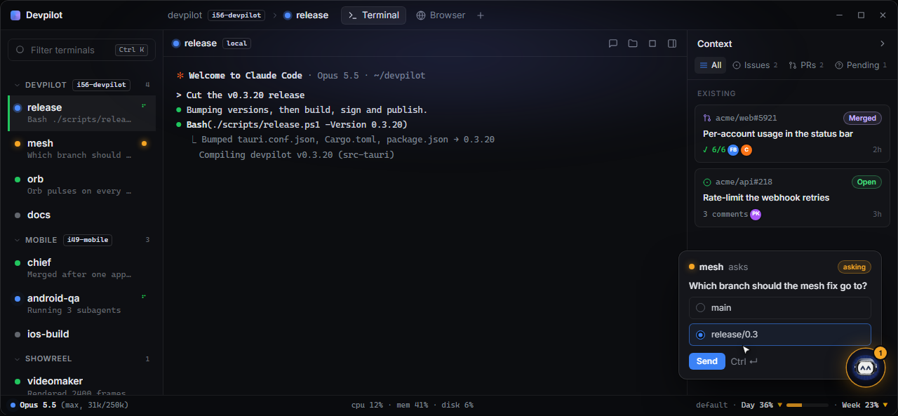
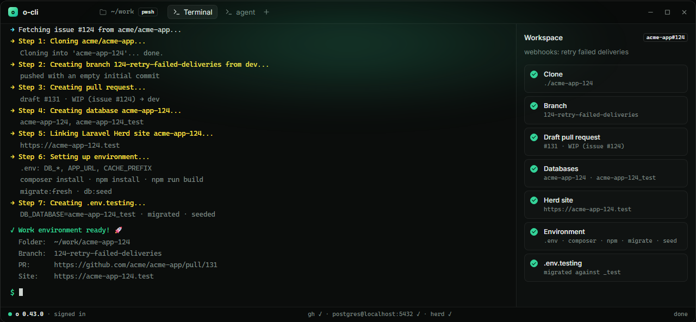
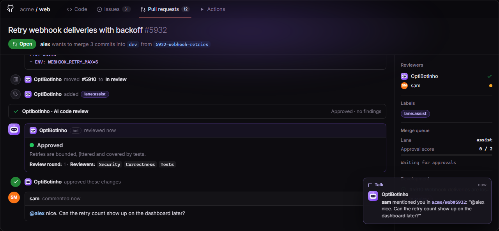
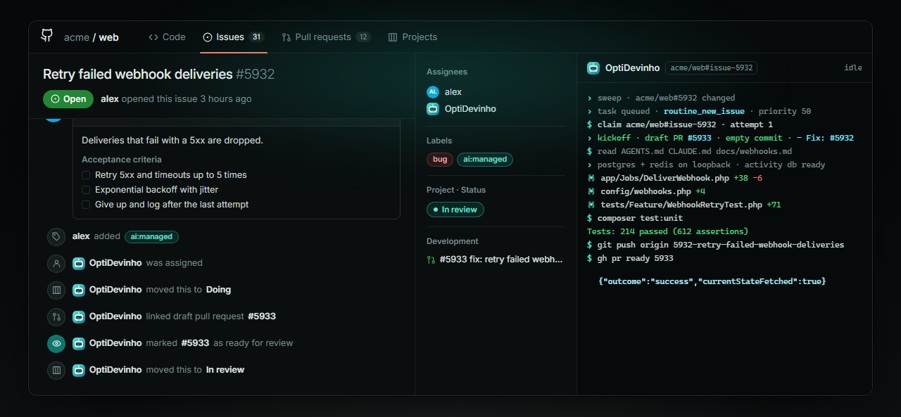
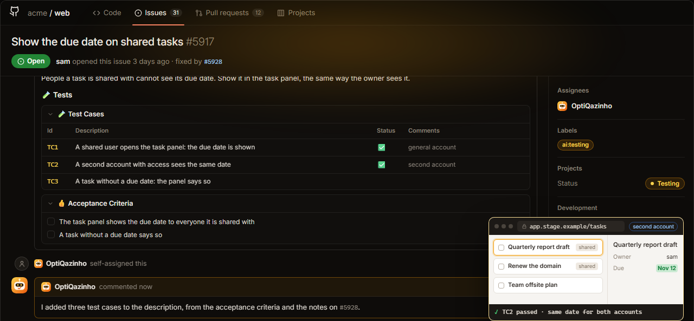
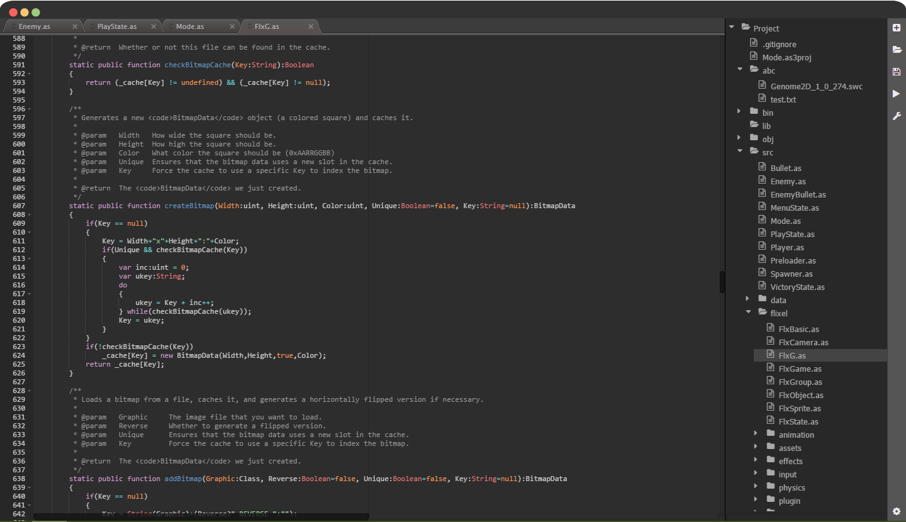
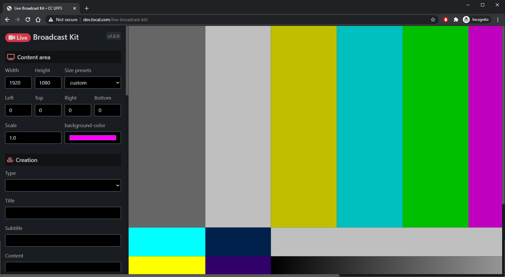
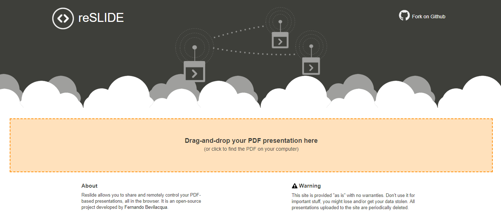
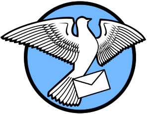

These projects span different stages of my career. Start with [the engineering stories](/engineering/) for the problem, decisions and impact behind Codebot and cvui. The catalogue below preserves the original projects and their period-specific stacks. More source code is on [GitHub](https://github.com/dovyski).

## Featured developer tools

**[Codebot](https://github.com/Dovyski/Codebot)** — I built a web-based IDE because game development work extends well beyond the code editor: assets, levels, sounds, documentation and publishing all interrupt the flow. Codebot explored how one environment could absorb more of that work.

**[Devpilot](/devpilot/)** — Running a dozen AI coding agents at once turned my desktop into a wall of terminals, and the bottleneck became knowing which one needed me. I built a Windows desktop app that groups the terminals, shows every agent's status live, collects their questions in one place and speaks up when one finishes.

**Optidata team tools** — At Optidata I build the tools our engineering team works with every day, and the AI teammates that work alongside it: [o-cli](/portfolio/software/o-cli/), our command line for the work around the code; [OptiBotinho](/portfolio/software/optibotinho/), a GitHub bot that reviews pull requests and runs the merge queue; [OptiDevinho](/portfolio/software/optidevinho/), an AI developer that takes issues to a reviewed pull request; and [OptiQazinho](/portfolio/software/optiqazinho/), an AI tester that checks every issue on stage.

**[cvui](https://github.com/Dovyski/cvui)** — OpenCV experimentation needed simple controls without another graphical backend. I created and maintained a small UI library rendered using OpenCV primitives, with documentation and both C++ and Python implementations.

## Historical project catalogue

___  

<h2>Devpilot Rust TypeScript Tauri</h2>

A Windows desktop app built with Tauri: a Rust back-end manages the terminal sessions, hooks and a small HTTP API, while a React/TypeScript front-end renders the terminals with xterm.js.

Devpilot is a terminal workspace for running many AI coding agents (Claude Code, Codex) in parallel. Terminals are grouped by initiative and show a live status (working, running a tool, asking, done). Agents' questions land in a single Pending tab, and long steps (deploys, test gates) report their progress. A context panel collects the pull requests, issues and links each session mentions, with one-click actions such as a local review. Mockups open in an in-app browser where you can give feedback. A floating orb tells you which terminal needs attention and speaks a short line when an agent finishes. Saved prompts and F-key launch specs handle repetitive commands, and a mesh connects sessions running on remote Linux machines.

    <a href="/devpilot/"> Website</a>

___

<h2>o-cli Go</h2>

A single Go binary for Windows, macOS and Linux that wraps git, the GitHub CLI, PostgreSQL, Laravel Herd and OpenSSH.

o is the internal command line of the Optidata engineering team. One command sets up an isolated workspace for an issue: clone, branch, environment files, test database and local site. Others cut releases and tags, open a shell in a stage container or a production pod, read and write team secrets behind TOTP, format Laravel code to the team style, manage board tasks and upload screenshots for pull requests. A Markdown review loop lets people comment on a plan in the browser and hands the comments back to an AI agent.

    <a href="/portfolio/software/o-cli/"> Website</a>

___

<h2>OptiBotinho PHP Laravel</h2>

A Laravel application that receives GitHub, chat and error-monitoring webhooks, with queue workers and AI reviewers running Claude Code and Codex.

OptiBotinho is the GitHub bot of the Optidata engineering team. A panel of AI reviewers checks every pull request for security, correctness and tests, and a manager verifies their findings against the head commit before posting. A merge queue sorts pull requests into risk lanes and merges them when reviews and checks allow. The bot also moves issues across the project board, posts chat notifications, triages production errors into issues, and runs commands such as cloning issues or reporting on a milestone.

    <a href="/portfolio/software/optibotinho/"> Website</a>

___

<h2>OptiDevinho Node.js Docker</h2>

Node.js services in Docker: a brain that reads GitHub and chat, a resolver that queues the work and a sandboxed worker that runs Claude Code or Codex.

OptiDevinho is an AI member of the development team. Label an issue and it opens a draft pull request, implements the change, runs the repository tests against local services, attaches screenshots of UI changes and asks for review. It answers review comments until the threads are resolved, and takes follow-ups and status questions in chat. It never merges or deploys to production; it posts as its own GitHub user, works inside a sandbox and stays within token limits.

    <a href="/portfolio/software/optidevinho/"> Website</a>

___

<h2>OptiQazinho Node.js Docker</h2>

One persistent Claude conversation coordinates a fleet of Node.js tester services in Docker, one per repository, that drive the app with Playwright.

OptiQazinho is an AI member of the QA team. When an issue reaches testing, it writes test cases from the acceptance criteria and the pull request, then drives the deployed app on stage in a real browser, with two accounts to check permissions. It reports the verdict on the issue with screenshots and repro steps, labels the result and moves the issue on the board. People can ask it about the queue or the outcome in chat.

    <a href="/portfolio/software/optiqazinho/"> Website</a>

___

<h2>cvui C++ OpenCV</h2>

A header-only C++ lib to create UI in OpenCV projects. I created this lib out of the need of creating a full GUI application using nothing but OpenCV.

A (very) simple UI lib built on top of OpenCV drawing primitives. Other UI libs, such as imgui, require a graphical backend (e.g. OpenGL) to work, so if you want to use imgui in a OpenCV app, you must make it OpenGL enabled, for instance. It is not the case with cvui, which uses only OpenCV drawing primitives to do all the rendering (no OpenGL or Qt required).

	<a href="https://github.com/Dovyski/cvui"> Source code</a>
    <a href="https://dovyski.github.io/cvui"> Website</a>

___

<h2>Codebot PHP MySQL Javascript</h2>

The back-end is PHP with no frameworks, serving REST APIs (speaking JSON). Front-end was built using HTML/CSS enhanced with jQuery, Bootstrap and some UI libs.

Codebot is a code editing program equipped with built-in tools to help you make your game faster (read full thoughts here). Developing a game is much more than just coding, you have to tweak art, build levels, convert files, find assets/extensions, read docs about building and publishing, and so on. The IDE should help us do that, or do it all by itself. Imagine you are working on your Ludum Dare/1GAM game and you need an 8-bit SFX. You click a button, a panel slides, you type in a few keywords, select what you want and done!

	<a href="https://github.com/Dovyski/Codebot"> Source code</a>
    <a href="https://codebot.cc"> Website</a>

___

<h2>Live Broadcast Kit Javascript HTML CSS</h2>

A javascript app that authors digital content loaded as iframes. Loaded content is dynamically arranged according to user settings.

Live Broadcast Kit (LBK) is a web app to easily and effortlessly create overlays for video content. It has been originally designed to work in conjunction with OBS to add and control overlays on live feeds, however it can be used as a standalone app as well. LBK has been developed to help with broadcast and video content creation within the Computer Science program at Federal University of Fronteira Sul, Chapecó, Brazil.

	<a href="https://github.com/ccuffs/live-broadcast-kit"> Source code</a>
	<a href="https://livebk.app.uffs.cc"> Website</a>

___  

<h2>Reslide PHP Javascript</h2>

A javascript front-end shows a PDF presentation using PDF.js. Current slide of the presentation is controled by the back-end (PHP using files) via AJAX requests.

Share and remotely control your PDF-based presentations, all in the browser, without plugins or network restrictions. The process is simple: first you upload a PDF file to the website (no login required). When the upload is complete you receive two URLs: one for the presenter (can change the slides) and another for the viewers (can't change the slides). That's all!

	<a href="https://github.com/Dovyski/reslide"> Source code</a>
	<a href="https://reslide.fernandobevilacqua.com"> Website</a>

___  

<h2>Besearcher PHP SQLite Javascript</h2>

A daemon (PHP/SQLite) controls the execution of several tasks. A web interface (PHP/HTML/CSS/Javascript) allows the monitoring and control of the daemon.

Besearcher (bot researcher) is a cross-platform tool to help researchers automate and keep track of software-based experiments. The main idea to define a command, its parameters and the possible values of those parameters. Besearcher will then generates all permutations of that command and its parameter values. It will execute each one of them, keeping track of their status (running, finished or aborted) and the output they produced.

	<a href="https://github.com/Dovyski/Besearcher"> Source code</a>

___  

<h2>Pigeon PHP</h2>

PHP microservice that communicates using a REST API exposes system capabilities regarding e-mail sending.

Pigeon is an easy to use, hassle-free PHP microservice for sending e-mails via HTTP requests. It values simplicity above all, i.e. no database required, extremely easy and quick installation. It is intended for small, in-house projects that require e-mail sending capabilities.

	<a href="https://github.com/Dovyski/Pigeon"> Source code</a>

___

<h2>Jarena Java</h2>

I developed this project as a tool for my OOP classes. It is a gamified way of developing and learning about Java classes and objects. All rendering code is based on AWT.

A game approach to teaching OPP and Java. It is a battle arena where student-developed agents fight each other in order to survive. The last team to be eliminated from the arena wins the challenge.

	<a href="https://github.com/Dovyski/Jarena"> Source code</a>

___

<h2>Sac PHP MySQL Javascript</h2>

A MVC web application built with PHP (back-end) and HTML/CSS/Javascript (front-end).

A web app to manage tiny conferences. It allows administrators to manage payments, schedules, attendance lists, competitions, rooms, etc. Visitors can book the events they want to participate.

	<a href="https://github.com/Dovyski/Sac"> Source code</a>

___

<h2>Aura PHP MySQL Javascript</h2>

Web part built using PHP/MySQL and the aura-client is PHP  running as a command line app on every computer to be managed.

A tool with limited AI capabilities to manage computers in academic labs. It is composed of two parts: the web part (PHP/MySQL) and the aura-client (PHP, running as a command line app on every computer to be managed).

	<a href="https://github.com/Dovyski/Aura"> Source code</a>

___

<h2>Progbot PHP MySQL Javascript</h2>

A MVC web application built with PHP (back-end) and HTML/CSS/Javascript (front-end).

Progbot is a PHP/MySQL webapp to manage programming assignments. It allows professors to add and organize programming challenges, as well as grade them in an easy an contextual way. Students can keep track of solved challenges, deadlines and grading comments. It's is also possible to code directly in the browser, which avoids the hassle of configuring a complete programming tool chain (if that is not part of the deal).

	<a href="https://github.com/Dovyski/Progbot"> Source code</a>

